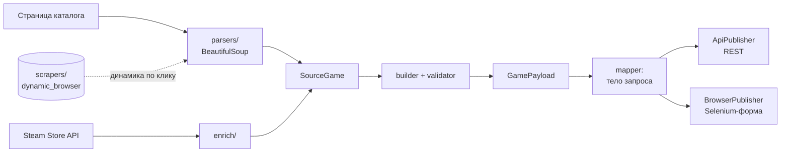

<div align="center">

# 🎮 steam-enrich-scraper

**Пайплайн скрапинг → обогащение → публикация для данных об играх.**

Парсит страницу игры, обогащает её метаданными из публичного API Steam и публикует запись
через REST API или Selenium-автозаполнение веб-формы — что поддерживает площадка.


</div>

> Демонстрация техник на нейтральных синтетических фикстурах («Пример-магазин»):
> проект не нацелен ни на один реальный сторонний сайт и не содержит его. Источник
> и паблишеры задаются через `.env`.

---

## Как это работает



- **Рукописные парсеры.** BeautifulSoup + CSS-селекторы: поля, значения из атрибутов,
  блок с `<br>` → чистый текст, разбор свободного текста системных требований, и добор
  блока, которого нет в статичном HTML — он подгружается лениво через **AJAX**.
- **Работа с REST API.** Клиент метаданных Steam и паблишер с ретраями (ограниченный
  экспоненциальный backoff), учётом `Retry-After` и типизированными ошибками
  (auth / duplicate / общая).
- **Selenium в двух ролях.** *Скрапинг* динамики, которая появляется только после клика,
  и *публикация* заполнением веб-формы на залогиненном профиле — с намеренной проверкой
  человеком перед отправкой.
- **Чистая архитектура.** parsers → enrich → services (build/validate/map) → publishers,
  крошечное SQLite-хранилище для дедупликации и офлайн-тесты на фикстурах.

## Быстрый старт

```bash
python -m venv .venv
source .venv/bin/activate        # Windows: .venv\Scripts\activate
pip install -r requirements.txt

# офлайн-тесты (без сети, на фикстурах)
python -m pytest -q

# dry-run всего пайплайна на вложенной фикстуре
# (шаг обогащения Steam ходит в публичный Steam API)
python main.py --demo
```

Обработать реальную страницу и посмотреть тело REST-запроса, ничего не отправляя:

```bash
python main.py "https://store.example.com/game/some-game" --publisher api
# добавь --submit, чтобы реально опубликовать (нужен PUBLISH_API_KEY в .env)
```

## Структура

| Каталог | Что внутри |
| :--- | :--- |
| `parsers/` | рукописные парсеры каталога и страницы игры |
| `enrich/` | клиент API магазина Steam |
| `scrapers/` | Selenium headless-скрапер динамики |
| `publishers/` | `ApiPublisher` (REST) и `BrowserPublisher` (Selenium-форма) |
| `services/` | сборка, валидация, фильтр ссылок, маппер тела запроса |
| `storage/` | sqlite-хранилище для дедупликации |
| `models/` | датаклассы (`SourceGame`, `SteamData`, `GamePayload`) |
| `fixtures/` | синтетический HTML примера-магазина для тестов и `--demo` |
| `tests/` | офлайн-тесты |

## Конфигурация

Скопируй `.env.example` в `.env`. Секреты (API-ключи) читаются только из окружения и
нигде не захардкожены — см. `config.py`.

## Лицензия

MIT — см. [LICENSE](LICENSE).
